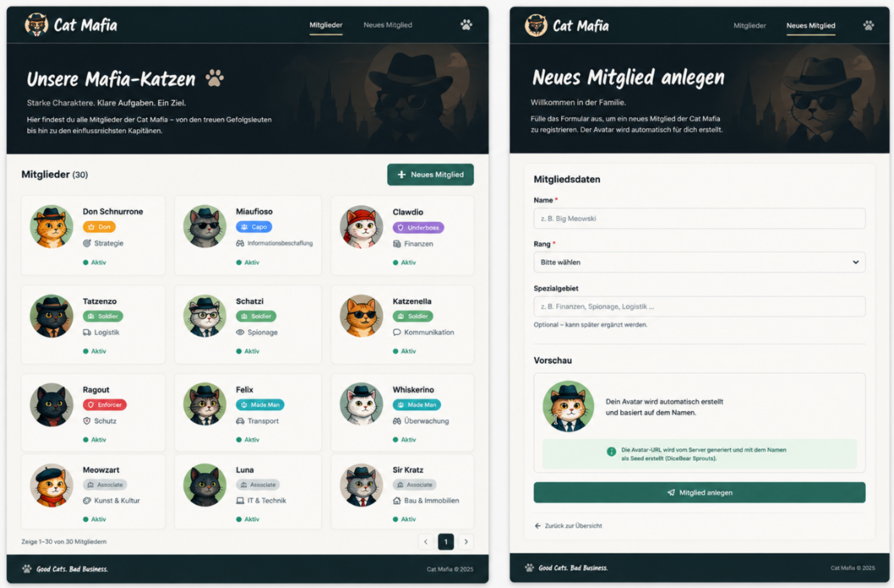

Ein Frontend zum Anzeigen der Katzen und zum erstellen neuer Katzen.

Das backend ist express.js, denkt an cors, denkt an json()

Wir brauchen 2 Endpunkte
/api/members GET liefert alle Mitglieder als JSON zurück

/api/members POST legt ein neues Mitglied an und speichert es in members.json

```json
{
    "id": 2,
    "name": "Miaufioso",
    "rank": "Capo",
    "specialty": "Informationsbeschaffung",
    "avataUrl": "https://robohash.org/peter.png?set=set4",
    "status": "active"
}
```

Frontend:
Das Formular muss via JavaScript verarbeitet werden.
Es soll nicht zum neuladen der Seite kommen.
Ich möchte ein JSON ins Backend senden, kein contenttype formUrlEncoded.
Wir brauchen Feedback nach dem absenden

Vorschau kann, muss aber nicht.



